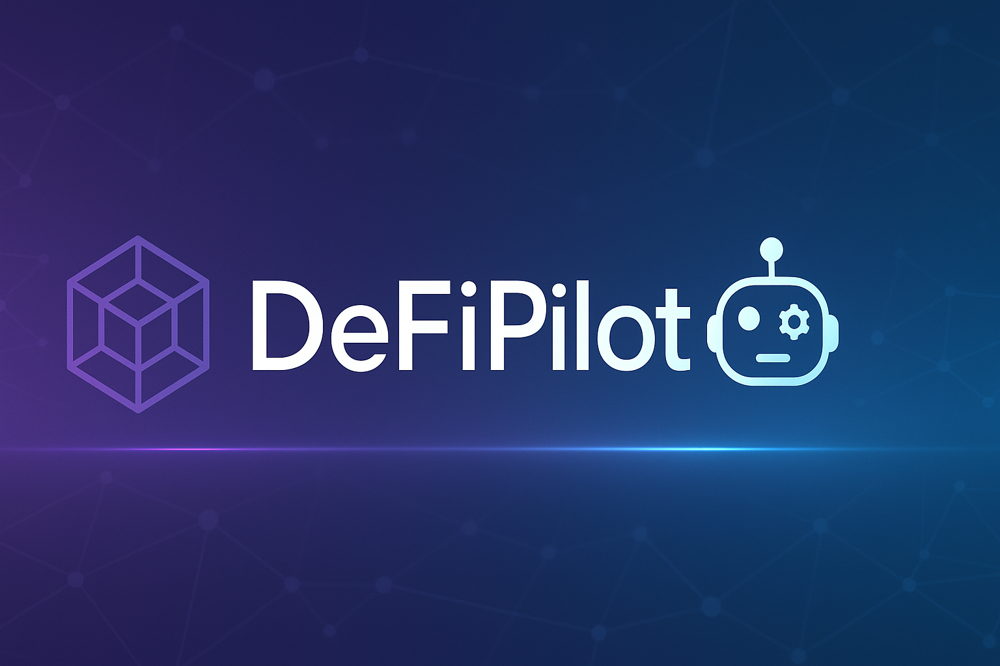
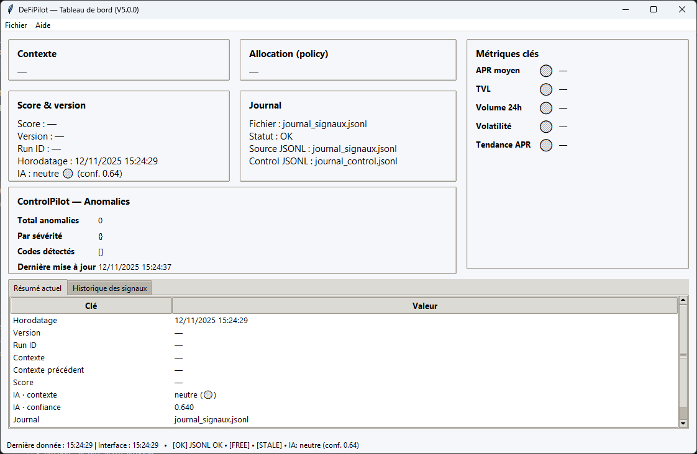

> 🗣️ **Langue / Language :** le bot fonctionne uniquement en **français** pour le moment.  
> The bot currently works **in French only** for the moment.

---

## 📚 Sommaire / Table of Contents
1. [Introduction / Introduction](#1-introduction--introduction)  
2. [Fonctionnalités principales / Key Features](#2-fonctionnalites-principales--key-features)  
3. [Aperçu visuel / Visual Overview](#3-apercu-visuel--visual-overview)  
4. [Nouveautés / What's New — Version 6.4.0](#4-nouveautes--whats-new--version-640)  
5. [Historique des versions / Past Versions](#5-historique-des-versions--past-versions)  
6. [Caractéristiques techniques / Technical Highlights](#6-caracteristiques-techniques--technical-highlights)  
7. [Prérequis / Requirements](#7-prerequis--requirements)  
8. [Installation / Installation](#8-installation--installation)  
9. [Utilisation / Usage](#9-utilisation--usage)  
10. [Feuille de route / Roadmap](#10-feuille-de-route--roadmap)  
11. [Vision du projet / Project Vision](#11-vision-du-projet--project-vision)  
12. [FAQ / Foire aux questions](#12-faq--foire-aux-questions)  
13. [À propos de l’auteur / About the Author](#13-a-propos-de-lauteur--about-the-author)  
14. [Crédits techniques / Technical Credits](#14-credits-techniques--technical-credits)  
15. [Licence / License](#15-licence--license)  
16. [Dernière révision / Last Review](#16-derniere-revision--last-review)

---

# 1. 🧭 Introduction / Introduction

## FR
DeFiPilot est un bot DeFi autonome conçu pour analyser en continu les opportunités disponibles sur les échanges décentralisés (DEX), calculer la rentabilité réelle des pools, puis sélectionner les meilleures options en fonction d’un profil d’investissement configurable. Le système fonctionne aussi bien en mode simulation qu’en mode réel selon la configuration utilisateur.

Son architecture repose sur quatre principes :  
- **Robustesse** : tolérance aux erreurs réseau, redondances, vérifications multiples.  
- **Modularité** : possibilité d’étendre facilement les fonctionnalités via modules.  
- **Transparence** : journalisation complète (CSV + JSONL), état sauvegardé, historique visible.  
- **Automatisation** : analyse continue, décisions guidées par les profils, reprise automatique.

DeFiPilot vise à constituer une base sérieuse et pérenne pour gérer des investissements DeFi automatisés, tout en intégrant des mécanismes de sécurité pour réduire les risques opérationnels.

## EN
DeFiPilot is an autonomous DeFi bot designed to continuously analyze opportunities across decentralized exchanges (DEX), compute real profitability for liquidity pools, and select the best options according to a configurable investment profile. The system runs in both simulation and real execution modes depending on user configuration.

Its architecture relies on four core principles:  
- **Robustness**: tolerance to network failures, redundancy, multiple safety checks.  
- **Modularity**: easily extendable through additional modules.  
- **Transparency**: full logging (CSV + JSONL), state storage, visible history.  
- **Automation**: continuous analysis, profile‑driven decisions, automatic state recovery.

DeFiPilot aims to be a serious and sustainable foundation for automated DeFi investment management while embedding safety mechanisms to minimize operational risks.

---

# 2. ⚙️ Fonctionnalités principales / Key Features

## FR
- Analyse automatique des pools (APR, TVL, volume, volatilité, slippage).  
- Scoring pondéré basé sur plusieurs profils (Prudent, Modéré, Risque).  
- Mode simulation complet avec garde-fou (`DryRunGuard`) pour tests sécurisés sans risque.  
- Mode réel avec moteur d'exécution Web3, gestion EIP-1559, slippage guard et confirmations on-chain.  
- **Gestion active du capital (Phase 2 achevée)** : sécurisation automatique des profits (`ProfitSweeper`), réinvestissement dégressif (`TimeDecayCompounder`), et callbacks d'arbitrage sécurisés avec injection de dépendances.  
- Interface graphique Tkinter avec rafraîchissement automatique.  
- Multi-wallets avec séparation des usages.  
- Supervision IA via ControlPilot (signaux contextuels).  
- Résilience et reprise automatique après coupure (fichiers `state.json` et `health.json`).  
- Journalisation détaillée (JSONL + CSV).  
- Architecture modulaire extensible.

## EN
- Automatic pool analysis (APR, TVL, volume, volatility, slippage).  
- Weighted scoring based on multiple profiles (Conservative, Moderate, Risk).  
- Full simulation mode with safety guard (`DryRunGuard`) for zero-risk testing.  
- Real mode powered by Web3 execution engine, EIP-1559 gas estimation, slippage guard, and on-chain confirmations.  
- **Active capital management (Phase 2 completed)**: automated profit sweeping (`ProfitSweeper`), dynamic time-decay compounding (`TimeDecayCompounder`), and secured routing callbacks with dependency injection.  
- Tkinter GUI with automatic refresh.  
- Multi‑wallet support.  
- AI supervision via ControlPilot (context signals).  
- System resilience and automatic resume after shutdown (`state.json` and `health.json`).  
- Detailed logging (JSONL + CSV).  
- Modular and extensible architecture.

---

# 3. 🖥️ Aperçu visuel / Visual Overview

## FR
L’interface graphique de DeFiPilot présente les métriques clés, l’état du bot, les signaux AI de ControlPilot, la liste des pools analysées, et les indicateurs de stratégie actifs.

## EN
DeFiPilot’s graphical interface displays key metrics, bot status, ControlPilot AI signals, list of analyzed pools, and active strategy indicators.

---

# 4. 🆕 Nouveautés / What's New — Version 6.4.0

## 📘 Fr
- **Cycle du capital & Articulation Option B (Phase 2.3) :** Intégration unifiée du cycle du capital reliant `TimeDecayCompounder` et `ProfitSweeper` dans `main_v6_core.py`.
- **Callbacks d'exécution sécurisés (`reinvest_action` & `secure_action`) :**
  - **Mode simulation (`dry_run=True`) :** Journalisation formelle des arbitrages (`[PROFIT_SWEEPER]` / `[COMPOUNDING]`) et suivi d'état simulé en mémoire sans interaction blockchain.
  - **Mode réel sécurisé (`dry_run=False`) :** Injection de dépendances (`transfer_executor`, `liquidity_executor`), validation stricte de l'adresse de réserve (`RESERVE_WALLET_ADDRESS` / `SAFE_WALLET_ADDRESS` au format hexadécimal checksum 0x) et garde-fou bloquant toute exécution en cas d'adresse invalide ou manquante (`CapitalActionError`).
- **Résilience financière :** Capture locale des incidents non bloquante, préservation intégrale de la réserve en cas d'échec de balayage, et mise en file d'attente automatique (`pending_reinvest`) pour prévenir toute perte de capital.
- **Calculs haute précision :** Arithmétique financière en `Decimal` avec stockage textuel des positions simulées afin de proscrire toute dérive de virgule flottante.
- **Suite de tests étendue :** Couverture portée à **93 tests unitaires et E2E au vert** sans régression.

---

## 📗 En
- **Capital Cycle & Option B Articulation (Phase 2.3):** Unified capital flow orchestration linking `TimeDecayCompounder` and `ProfitSweeper` within `main_v6_core.py`.
- **Secured Execution Callbacks (`reinvest_action` & `secure_action`):**
  - **Simulation mode (`dry_run=True`):** Standardized audit logging (`[PROFIT_SWEEPER]` / `[COMPOUNDING]`) and in-memory simulated tracking with zero blockchain interaction.
  - **Secured real mode (`dry_run=False`):** Dependency injection (`transfer_executor`, `liquidity_executor`), strict reserve wallet validation (`RESERVE_WALLET_ADDRESS` / `SAFE_WALLET_ADDRESS` checksum hex format), and blocking guards on missing or invalid configurations (`CapitalActionError`).
- **Financial Resilience:** Non-blocking error handling, full reserve retention on failed sweep, and automated queuing (`pending_reinvest`) preventing capital loss.
- **High-Precision Arithmetic:** Strict `Decimal` calculations and string-serialized position persistence eliminating floating-point drift.
- **Expanded Test Suite:** Full test suite upgraded to **93 unit and E2E tests passing green** with zero regressions.

---

# 5. 🕓 Historique des versions / Past Versions

## 📘 Fr
- **V6.4.0 :** Finalisation Phase 2.3 (articulation Option B du capital, callbacks sécurisés simulation/réel avec injection d'exécuteurs, garde-fous stricts sur l'adresse de réserve, 93 tests au vert).  
- **V6.3.0 :** Couche de gestion active du capital (`ProfitSweeper` + `TimeDecayCompounder`), orchestration `CapitalCycleManager` dans `main_v6_core.py` et validation de 72 tests au vert.  
- **V6.2.0 :** Moteur d'exécution on-chain réel validé sur Polygon Mainnet, intégration PoA Bor, GasEstimator EIP-1559 calibré, SlippageGuard, script de swap sécurisé et 45 tests unitaires au vert.  
- **V6.1 :** Moteur de simulation sécurisé (Dry-Run Guard), algorithme de scoring fiabilisé, gestion de résilience système (`system_health.py`) et validation complète par tests E2E (29 tests au vert).  
- **V6.0 :** Refonte Core V6, scoring des pools, daemon de journalisation de stratégie sécurisé, refonte de la couche d'exécution réelle et nettoyage legacy.  
- **V5.5 :** Exits automatiques basés sur le contexte, application des seuils Deep Search V5.4, stratégie finalisée (`strategy_v5_5.json`), stabilisation complète du daemon.  
- **V5.3 :** Journal stratégique dédié (`journal_strategy.jsonl`), intégration complète des signaux normalisés de ControlPilot, stabilisation du daemon.  
- **V5.2 :** Rééquilibrage automatique du portefeuille, signaux pondérés, snapshots de rééquilibrage, mise à jour scoring/stratégie.  
- **V5.1 :** Nouveau moteur de signaux IA, normalisation avancée, scoring dynamique, stratégie enrichie.  
- **V5.0 :** Intégration IA ControlPilot, stabilité renforcée, dashboard optimisé.  
- **V4.9 :** Agrégation avancée des signaux + détection d’anomalies.  
- **V4.8 :** Collecte des signaux simples (début ControlPilot).  
- **V4.7 :** Stabilisation complète du mode réel + reprise automatique.  
- **V4.6 :** Stratégie dynamique avec ajustements automatiques.  
- **V4.5 :** Améliorations GUI + affichage contextuel.  
- **V4.2 :** Scoring pondéré + gestion des profils.  
- **V4.0 :** Passage au simulateur complet.

---

## 📗 En
- **V6.4.0:** Completed Phase 2.3 (Option B capital flow articulation, secured simulation/real callbacks with executor injection, strict reserve wallet safeguards, 93 passing tests).  
- **V6.3.0:** Active capital management layer (`ProfitSweeper` + `TimeDecayCompounder`), `CapitalCycleManager` orchestration in `main_v6_core.py`, and 72 passing tests.  
- **V6.2.0:** Validated live on-chain execution engine on Polygon Mainnet, Bor PoA middleware integration, calibrated EIP-1559 GasEstimator, SlippageGuard, guarded test swap script, and 45 passing unit tests.  
- **V6.1:** Secured dry-run simulation mode (Dry-Run Guard), refined scoring algorithm, system health resilience (`system_health.py`), and full validation with 29 E2E integration tests.  
- **V6.0:** Core V6 refactoring, pool scoring engine, secure strategy logging daemon, execution layer fixes and workspace reorganization.  
- **V5.5:** Automatic exits based on market context, integration of Deep Search V5.4 thresholds, finalized strategy file (`strategy_v5_5.json`), full daemon stabilization.  
- **V5.3:** Dedicated strategic journal (`journal_strategy.jsonl`), full ControlPilot signal integration.  
- **V5.2:** Automatic portfolio rebalancing, weighted signals, snapshots, and stabilized pipeline.  
- **V5.1:** New AI signal engine, dynamic scoring, enriched strategy.  
- **V5.0:** ControlPilot AI integration + real-mode stabilization.  
- **V4.9:** Advanced signal aggregation + anomaly detection.  
- **V4.8:** Simple signal collection (start of ControlPilot).  
- **V4.7:** Full real-mode stabilization + auto-resume.  
- **V4.6:** Dynamic strategy with automatic adjustments.  
- **V4.5:** GUI improvements + contextual display.  
- **V4.2:** Weighted scoring + profile management.  
- **V4.0:** Full simulation mode.

---

# 6. 🧱 Caractéristiques techniques / Technical Highlights

## FR
DeFiPilot repose sur une architecture modulaire, pensée pour garantir évolutivité et stabilité :

- **`main_v6_core.py` / `run_defipilot_v6.py`** — Points d'entrée principaux du moteur V6, orchestration unifiée du capital (`CapitalCycleManager`) et callbacks d'exécution (`reinvest_action`, `secure_action`).  
- **`core/`** — Analyse, scoring des pools, gestion active du capital (`capital/` avec `profit_sweeper.py`, `compounding.py`), garde-fous (`guardrails.py`, `dry_run_guard.py`), suivi de santé système (`system_health.py`), validation d'environnement (`env_validator.py`), CLI (`cli.py`), exécution on-chain sécurisée (`execution/` avec `rpc_manager.py`, `gas_estimator.py`, `slippage_guard.py`).  
- **`scripts/`** — Outils opérationnels contrôlés (`execute_controlled_test_swap.py`, `preflight_check.py`).  
- **`config/`** — Configurations stratégiques (`strategy_v6_0.json`, `strategy_v5_5.json`), paramètres de seuil et de compounding.  
- **`journal_daemon_v6_secure.py` / `analyser_logs.py`** — Daemon de suivi de stratégie et utilitaire d'analyse des journaux.  
- **`tests/`** — Suite de 93 tests automatisés couvrant les simulations E2E, le scoring, la résilience, la gestion du gaz EIP-1559, le slippage, le mode dry-run, le balayage de profits, le compounding dégressif et les callbacks avec garde-fous.  
- **`data/`** — État persistant du bot (`state.json`, `health.json`).

Le bot utilise principalement **Python 3.11**, **Web3.py**, **Tkinter**, **Pandas**, et l’API **DefiLlama**.

## EN
DeFiPilot is built on a modular architecture designed for scalability and stability:

- **`main_v6_core.py` / `run_defipilot_v6.py`** — Core entry points for the V6 engine execution, unified capital orchestration (`CapitalCycleManager`), and execution callbacks (`reinvest_action`, `secure_action`).  
- **`core/`** — Analysis, pool scoring, active capital management (`capital/` with `profit_sweeper.py`, `compounding.py`), safety guards (`guardrails.py`, `dry_run_guard.py`), system health management (`system_health.py`), environment validation (`env_validator.py`), CLI (`cli.py`), secure on-chain execution (`execution/` with `rpc_manager.py`, `gas_estimator.py`, `slippage_guard.py`).  
- **`scripts/`** — Controlled operational tools (`execute_controlled_test_swap.py`, `preflight_check.py`).  
- **`config/`** — Strategic configurations (`strategy_v6_0.json`, `strategy_v5_5.json`), sweeping thresholds and compounding parameters.  
- **`journal_daemon_v6_secure.py` / `analyser_logs.py`** — Secure background strategy daemon and log analytics tool.  
- **`tests/`** — Automated test suite with 93 tests covering E2E simulations, scoring, resilience, EIP-1559 gas estimation, slippage, dry-run safety, profit sweeping, time-decay compounding, and guarded execution callbacks.  
- **`data/`** — State persistence engine (`state.json`, `health.json`).

The bot relies mainly on **Python 3.11**, **Web3.py**, **Tkinter**, **Pandas**, and the **DefiLlama** API.

---

# 7. 🔧 Prérequis / Requirements

## FR
- Python **3.11+**  
- Accès RPC Polygon (Infura, Alchemy, QuickNode ou PublicNode)  
- Wallet compatible (Rabby, MetaMask)  
- Connexion Internet stable  
- Git installé

## EN
- Python **3.11+**  
- Polygon RPC access (Infura, Alchemy, QuickNode, or PublicNode)  
- Compatible wallet (Rabby, MetaMask)  
- Stable Internet connection  
- Git installed

---

# 8. ⚙️ Installation / Installation

## FR
1. **Cloner le dépôt :**  
`git clone https://github.com/DavidRaffeil/DeFiPilot.git`  
`cd DeFiPilot`

2. **Créer l’environnement virtuel et installer les dépendances :**  
`python3.11 -m venv .venv`  
`source .venv/bin/activate` *(Windows : `.venv\Scripts\activate`)*  
`pip install -U pip`  
`pip install -r requirements.txt`

3. **Configurer le fichier `.env` :**  
`NETWORK=polygon`  
`POLYGON_RPC_URL=https://polygon-mainnet.infura.io/v3/YOUR_PROJECT_ID`  
`WALLET_ADDRESS=YOUR_WALLET_ADDRESS`  
`LOG_LEVEL=INFO`

4. **Vérifier l’installation :**  
`python scripts/preflight_check.py`

## EN
1. **Clone the repository:**  
`git clone https://github.com/DavidRaffeil/DeFiPilot.git`  
`cd DeFiPilot`

2. **Create a virtual environment and install dependencies:**  
`python3.11 -m venv .venv`  
`source .venv/bin/activate` *(Windows: `.venv\Scripts\activate`)*  
`pip install -U pip`  
`pip install -r requirements.txt`

3. **Configure the `.env` file:**  
`NETWORK=polygon`  
`POLYGON_RPC_URL=https://polygon-mainnet.infura.io/v3/YOUR_PROJECT_ID`  
`WALLET_ADDRESS=YOUR_WALLET_ADDRESS`  
`LOG_LEVEL=INFO`

4. **Verify installation:**  
`python scripts/preflight_check.py`

---

# 9. ▶️ Utilisation / Usage

## FR
- **Lancement V6 Core (Mode principal) :** `python run_defipilot_v6.py`
- **Exécution des tests automatisés (93 tests) :** `pytest`
- **Test de pré-vol environnement :** `python scripts/preflight_check.py`
- **Test de swap contrôlé (Dry-Run) :** `python scripts/execute_controlled_test_swap.py --dry-run`
- **Lancement du Daemon de Journalisation :** `python journal_daemon_v6_secure.py`
- **Analyse des journaux d'exécution :** `python analyser_logs.py`

## EN
- **Launch V6 Core Engine (Main mode):** `python run_defipilot_v6.py`
- **Run automated test suite (93 tests):** `pytest`
- **Environment preflight check:** `python scripts/preflight_check.py`
- **Controlled test swap (Dry-Run):** `python scripts/execute_controlled_test_swap.py --dry-run`
- **Launch Secure Background Logging Daemon:** `python journal_daemon_v6_secure.py`
- **Analyze execution logs:** `python analyser_logs.py`

---

# 10. 🚀 Feuille de route / Roadmap

## 📘 Fr

### Prochaines versions
- **V6.5 :** Synchronisation multi-bots (DeFiPilot + ControlPilot + ArbiPilot).  
- **V6.6 :** Déploiement sur Orange Pi / infrastructure SBC.  

### Versions finalisées
- **V6.4.0 :** Finalisation Phase 2.3 (articulation Option B du capital, callbacks sécurisés simulation/réel avec injection d'exécuteurs, garde-fous stricts sur l'adresse de réserve, 93 tests au vert).  
- **V6.3.0 :** Gestion du capital (`ProfitSweeper`, `TimeDecayCompounder`), orchestration `CapitalCycleManager` et 72 tests automatisés validés.  
- **V6.2.0 :** Moteur d'exécution on-chain validé en direct sur Polygon, intégration PoA Bor, gestion EIP-1559, SlippageGuard et 45 tests unitaires.  
- **V6.1 :** Simulation sécurisée (Dry-Run Guard), scoring de rééquilibrage, gestion de santé système et suite de 29 tests E2E.  
- **V6.0 :** Mode unifié V6 Core, scoring des pools, daemon de journalisation sécurisé, réorganisation du dépôt.  
- **V5.5 :** Exits automatiques, intégration des seuils Deep Search, stratégie finalisée `strategy_v5_5.json`, stabilisation du daemon.  
- **V5.3 :** Journal stratégique dédié (`journal_strategy.jsonl`), intégration complète des signaux ControlPilot.  
- **V5.2 :** Rééquilibrage automatique, signaux pondérés, snapshots et pipeline stabilisé.  
- **V5.1 :** Nouveau moteur de signaux IA, scoring dynamique et stratégie enrichie.  
- **V5.0 :** Intégration ControlPilot + stabilisation mode réel.

---

## 📗 En

### Upcoming Versions
- **V6.5:** Multi-bot synchronization (DeFiPilot + ControlPilot + ArbiPilot).  
- **V6.6:** Deployment on Orange Pi / SBC architecture.  

### Completed Versions
- **V6.4.0:** Completed Phase 2.3 (Option B capital flow articulation, secured simulation/real callbacks with executor injection, strict reserve wallet safeguards, 93 passing tests).  
- **V6.3.0:** Capital management layer (`ProfitSweeper`, `TimeDecayCompounder`), `CapitalCycleManager` orchestration, and 72 validated automated tests.  
- **V6.2.0:** Validated live on-chain execution on Polygon Mainnet, Bor PoA integration, EIP-1559 handling, SlippageGuard, and 45 unit tests.  
- **V6.1:** Secured dry-run simulation, rebalancing scoring, system health resilience, and 29 E2E test suite.  
- **V6.0:** Unified V6 Core mode, pool scoring engine, secure background logging daemon, codebase cleanup.  
- **V5.5:** Automatic exits, Deep Search threshold integration, finalized `strategy_v5_5.json`, full daemon stabilization.  
- **V5.3:** Dedicated strategic journal (`journal_strategy.jsonl`), full ControlPilot signal integration.  
- **V5.2:** Automatic rebalancing, weighted signals, snapshots, and stabilized pipeline.  
- **V5.1:** New AI signal engine, dynamic scoring, enriched strategy.  
- **V5.0:** ControlPilot integration + real-mode stabilization.

---

# 11. 🌍 Vision du projet / Project Vision

## FR
DeFiPilot vise à devenir une plateforme de gestion automatisée complète regroupant :  
- Analyse multi‑DEX, multi‑blockchains.  
- Stratégies dynamiques ajustées selon le marché.  
- Modules complémentaires (ControlPilot, ArbiPilot, LabPilot).  
- Architecture transparente et robuste centrée sur la sécurité et la pédagogie.

## EN
DeFiPilot aims to evolve into a complete automated management platform including:  
- Multi‑DEX, multi‑chain analysis.  
- Dynamic strategies adjusted to market conditions.  
- Complementary modules (ControlPilot, ArbiPilot, LabPilot).  
- Transparent and robust architecture focused on safety and clarity.

---

# 12. ❓ Foire aux questions / FAQ

## FR
**1. DeFiPilot effectue‑t‑il des transactions automatiquement ?**  
Oui, si le mode réel est activé et confirmé via l'environnement d'exécution. En mode simulation, aucune transaction blockchain n’est envoyée grâce au garde-fou `DryRunGuard`.

**2. Puis‑je utiliser DeFiPilot sans interface graphique ?**  
Oui, le bot fonctionne en ligne de commande de façon optimale avec `run_defipilot_v6.py`.

**3. Quels réseaux sont supportés ?**  
Polygon est supporté en natif avec gestion des spécificités Bor PoA. D’autres blockchains seront ajoutées progressivement.

**4. Les clés privées sont‑elles stockées en clair ?**  
Elles sont chargées via `.env` et jamais écrites dans les journaux.

**5. Quelle est la fréquence d’analyse ?**  
Elle dépend de la configuration, généralement quelques secondes.

**6. Comment fonctionne la reprise automatique ?**  
L’état est stocké dans le dossier `data/` (`state.json` et `health.json`), permettant au bot de reprendre après une coupure.

**7. Comment fonctionne la supervision IA ?**  
ControlPilot fournit des signaux contextuels (favorable, neutre, défavorable) influençant la stratégie.

**8. Les données de marché proviennent d’où ?**  
Principalement de DefiLlama, des Quoters de DEX et des RPC blockchain.

**9. Puis‑je ajouter mes propres stratégies ?**  
Oui, l’architecture modulaire permet d’étendre facilement les stratégies via le dossier `config/`.

**10. Le projet est‑il open source ?**  
Oui, sous licence CC‑BY‑NC‑SA 4.0.

---

# 13. 👤 À propos de l’auteur / About the Author

## 📘 Fr

**David Raffeil** est un passionné d’automatisation, de finance décentralisée et d’ingénierie logicielle appliquée.  
Il développe DeFiPilot depuis 2023 avec l’objectif de construire un écosystème complet et pédagogique autour de la DeFi, accessible aux utilisateurs motivés mais non spécialistes du développement.

Issu d’un parcours autodidacte, il a progressivement acquis des compétences en :
- architecture logicielle (Python 3.11, modules multi-couches)
- analyse on-chain et extraction de signaux DeFi
- automatisation, gestion d’état et reprise après coupure
- intégration Web3 et interactions blockchain sécurisées
- conception d’interfaces graphiques (Tkinter)
- structuration de journaux avancés (CSV/JSONL)
- méthodologie Git (branches, versions, tags, releases)

Son approche se caractérise par :
- un souci permanent de **fiabilité**
- une obsession de la **transparence**
- une volonté d’apprendre en construisant
- un usage pragmatique de l’IA (**Antigravity avec Gemini** et **ChatGPT**) comme copilotes de développement

DeFiPilot est conçu comme un projet de long terme :  
une plateforme modulaire, extensible, méthodologiquement propre, pouvant évoluer vers un cluster multi-bots (DeFiPilot, ControlPilot, ArbiPilot, LabPilot).

David souhaite également partager son expérience pour inspirer d’autres autodidactes à se lancer dans des projets techniques ambitieux, même en partant de zéro.

---

## 📗 En

**David Raffeil** is an enthusiast of automation, decentralized finance and applied software engineering.  
He has been developing DeFiPilot since 2023 with the goal of building a complete and educational DeFi ecosystem, accessible to motivated users—even those without a technical background.

Coming from a fully self-taught path, he progressively developed skills in:
- software architecture (Python 3.11, multi-layer modules)
- on-chain analysis and DeFi signal extraction
- automation, state management and crash-safe recovery
- Web3 integration and secure blockchain interactions
- graphical interface design (Tkinter)
- advanced logging systems (CSV/JSONL)
- Git methodology (branches, versions, tags, releases)

His approach is guided by:
- a constant focus on **reliability**
- strong commitment to **transparency**
- learning by building real projects
- pragmatic use of AI (**Antigravity with Gemini** and **ChatGPT**) as development copilots

DeFiPilot is intended as a long-term project:  
a modular, scalable platform that will evolve into a multi-bot cluster (DeFiPilot, ControlPilot, ArbiPilot, LabPilot).

David also hopes to share his journey to inspire other self-taught developers to tackle ambitious technical projects, even starting from scratch.

---

# 14. 🧩 Crédits techniques / Technical Credits

## FR
- Développement assisté par **Antigravity & Gemini** et **ChatGPT**.  
- Icônes, badges et éléments visuels issus de ressources libres.  
- Utilisation de **Web3.py**, **Tkinter**, **Pandas**, **DefiLlama API**.

## EN
- Development assisted by **Antigravity & Gemini** and **ChatGPT**.  
- Icons, badges and visuals use open free resources.  
- Built on **Web3.py**, **Tkinter**, **Pandas**, **DefiLlama API**.

---

# 15. 📜 Licence / License

## 📘 Fr — Licence d’utilisation

DeFiPilot est distribué sous une **licence d’utilisation personnelle et non commerciale**, sauf accord formel avec l’auteur.

Vous êtes autorisé à :
- utiliser le logiciel pour un usage **strictement personnel** ;
- modifier le code pour vos propres besoins ;
- étudier et analyser le fonctionnement du projet ;
- exécuter le logiciel en mode simulation ou réel sous votre propre responsabilité.

Vous n’êtes pas autorisé à :
- utiliser le logiciel dans un cadre **commercial**, professionnel ou lucratif **sans un contrat écrit signé avec l’auteur (David Raffeil)** ;
- vendre, louer, héberger ou distribuer une version modifiée ou non modifiée à des fins commerciales ;
- intégrer tout ou partie du projet dans un produit ou service commercial sans accord contractuel.

Toute redistribution non commerciale doit :
- créditer clairement l’auteur original (**David Raffeil**) ;
- inclure un lien vers le dépôt GitHub d’origine ;
- mentionner les éventuelles modifications.

### 🛡️ Clause de non-responsabilité

Le logiciel est fourni **“tel quel”, sans garantie** d’exactitude, de performance ou de sécurité.  
L’auteur ne peut être tenu responsable :
- de pertes financières directes ou indirectes ;
- d’une mauvaise configuration ou d'un usage inadapté ;
- d’erreurs liées à la blockchain ou à des RPC tiers ;
- de comportements inattendus dus à des smart contracts externes ;
- d’une utilisation non conforme aux recommandations.

L’utilisateur reconnaît utiliser DeFiPilot **à ses propres risques**, en comprenant les risques inhérents à la DeFi et aux interactions on-chain.

---

## 📗 En — Usage License

DeFiPilot is distributed under a **personal and non-commercial use license**, unless a formal agreement is signed with the author.

You are allowed to:
- use the software for **personal use only**;
- modify the code for your own needs;
- study and analyze the project;
- run the software in simulation or real mode at your own risk.

You are not allowed to:
- use the software in any **commercial, professional, or profit-oriented context without a written contract signed with the author (David Raffeil)**;
- sell, rent, host, or distribute modified or unmodified versions for commercial purposes;
- integrate any part of the project into a commercial product or service without contractual approval.

Any non-commercial redistribution must:
- clearly credit the original author (**David Raffeil**) ;
- include a link to the original GitHub repository ;
- state any modifications made.

### 🛡️ Disclaimer

This software is provided **“as is”, without any warranty** of accuracy, performance, or safety.  
The author cannot be held responsible for:
- direct or indirect financial losses ;
- misconfiguration or improper usage ;
- blockchain or third-party RPC failures ;
- unexpected behavior due to external smart contracts ;
- any use that does not follow the recommendations.

The user acknowledges that they use DeFiPilot **at their own risk**, understanding the inherent risks of DeFi and on-chain operations.

---

# 16. 🔍 Dernière révision / Last Review

**README V6.4.0 — mis à jour et consolidé.**  
**README V6.4.0 — updated and consolidated.**

---

© 2023-2026 DeFiPilot — Tous droits réservés.  
Projet distribué sous licence CC-BY-NC-SA 4.0.  
© 2023-2026 DeFiPilot — All rights reserved.  
Project distributed under the CC-BY-NC-SA 4.0 license.
